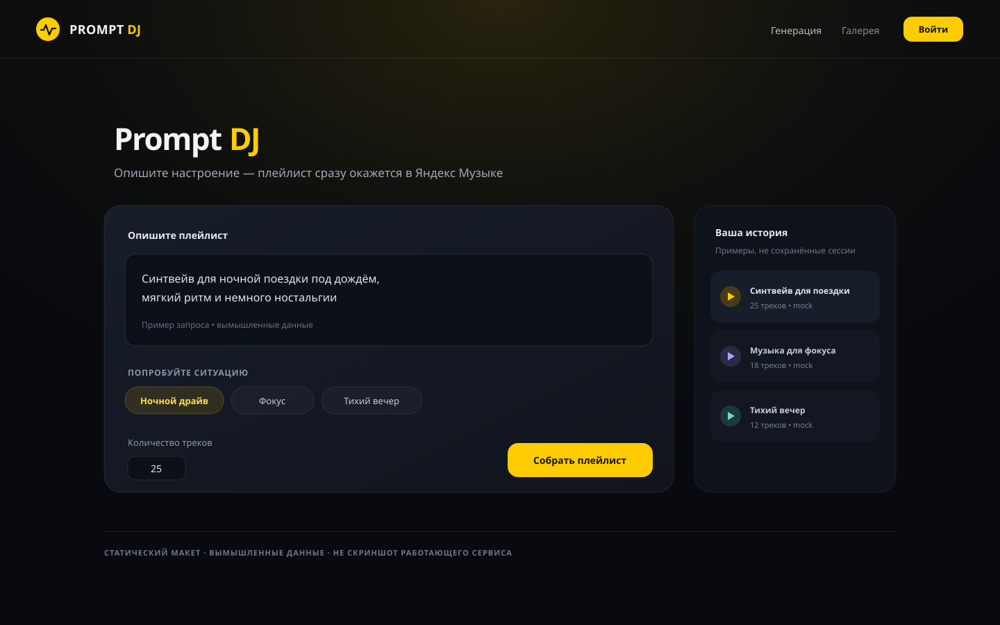
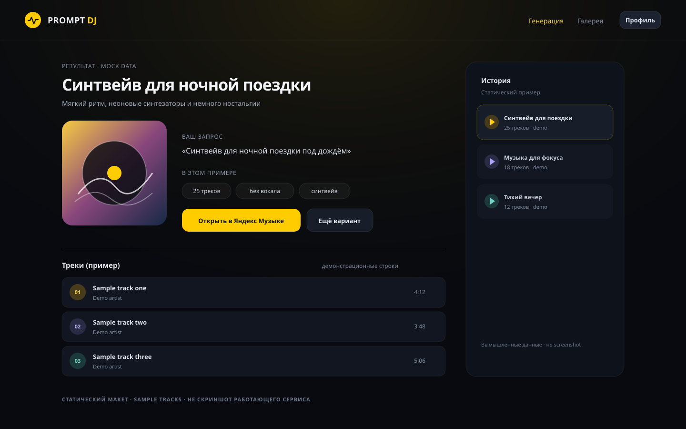

# Prompt DJ для Яндекс Музыки

Prompt DJ превращает текстовый запрос в музыкальный профиль, подбирает треки из
Яндекс Музыки и создаёт плейлист в аккаунте пользователя. В web-приложении есть
история генераций, повторный подбор, персонализация по библиотеке и обратная
связь.
Telegram Mini App — прототип интерфейса.

## Интерфейс

Макеты статические и используют вымышленные данные; это не скриншоты работающего
сервиса.

<p>
  
  
</p>

## Стек

| Часть | Технологии |
|---|---|
| API | Python 3.11+, FastAPI |
| Данные | PostgreSQL 15, SQLAlchemy 2, Alembic |
| Кэш | Redis 7 |
| Подбор | OpenAI-compatible API, sentence-transformers, NumPy |
| Web | Next.js 15, React 19, Tailwind CSS 4 |
| Telegram | aiogram 3, Telegram Mini App |

Подробности о версиях: [docs/STACK.md](docs/STACK.md).

## Проверить проект

Для backend нужны Python 3.12 и доступ к package index при первой установке. Из
корня репозитория запустите:

```bash
./scripts/test-backend.sh
```

Скрипт устанавливает dev-зависимости в отдельную среду, создаёт временный ключ
шифрования и запускает Ruff с pytest. Docker, БД, Redis и учётные данные внешних
API не нужны.

Frontend использует Node.js 20:

```bash
cd frontend
npm ci
npm run typecheck
npm test
```

## Локальный запуск

Для приложения нужны Python 3.12, Node.js 20 и Docker Compose. Подготовка backend
скачивает embedding-модель. Генерация плейлистов требует доступа к Яндекс Музыке
и `OPENAI_API_KEY`.

```bash
cp backend/.env.example backend/.env
./scripts/build-venv.sh
docker compose up -d db redis
cd backend
.venv/bin/python -m alembic upgrade head
.venv/bin/python -m uvicorn app.main:app --reload
```

Во втором терминале запустите web UI:

```bash
cd frontend
npm ci
npm run dev
```

UI: <http://localhost:3000>; API docs: <http://localhost:8000/docs>. Для auth
задайте `TOKEN_ENCRYPTION_KEY` в `backend/.env`.

### Запуск API и web через Compose

Dockerfile используют заранее подготовленные зависимости. На Linux x86_64:

```bash
./scripts/build-venv.sh
bash frontend/scripts/prepare-deps.sh
docker compose build api frontend
docker compose up -d db redis api frontend
docker compose exec -T api python -m alembic upgrade head
```

Compose сам задаёт адрес базы `db` внутри контейнеров.

## Конфигурация

Backend читает `backend/.env`; Compose переопределяет адреса PostgreSQL и Redis.
`NEXT_PUBLIC_API_URL` встраивается в web bundle во время `next build`. Поля
окружения описаны в [docs/CONFIGURATION.md](docs/CONFIGURATION.md).

## Структура проекта

```text
backend/app/   API, services, repositories, models, schemas
frontend/src/  Next.js routes, features, browser API client
scripts/       setup и проверки
docs/          продуктовая и инженерная документация
```

## Документация

Начните с [индекса документации](docs/README.md). Основные разделы:

- [архитектура](docs/ARCHITECTURE.md) и [REST API](docs/API.md);
- [локальный запуск](docs/OPERATIONS.md) и [тестирование](docs/TESTING.md);
- [конфигурация](docs/CONFIGURATION.md) и [безопасность](docs/SECURITY.md);
- [Telegram Mini App](docs/TELEGRAM.md).
