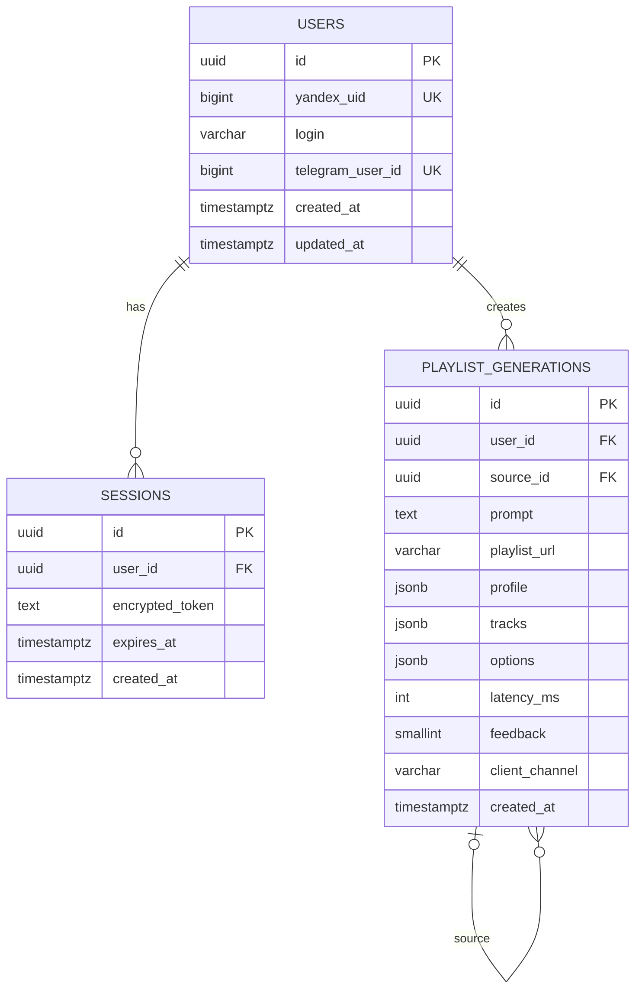

# База данных

## Технологии и подключение

Основное хранилище — PostgreSQL 15. Приложение использует SQLAlchemy 2
`AsyncSession` и asyncpg (`backend/app/db/session.py`). Alembic преобразует
`DATABASE_URL` в sync URL с psycopg2 через
`Settings.database_url_sync`.

Engine создаётся при импорте модуля с `pool_pre_ping=True`; при shutdown FastAPI
вызывает `engine.dispose()`. Dependency `get_db()` открывает одну сессию на
HTTP-запрос и закрывает её после ответа, но не делает автоматический commit.

## Модель данных



Полные ORM-модели находятся в `backend/app/db/models/`.

### `users`

- `yandex_uid`: unique index, идентичность аккаунта Яндекса;
- `telegram_user_id`: nullable unique index;
- удаление пользователя каскадно удаляет его sessions и generations как на
  уровне FK/relationship.

### `sessions`

- хранит не raw OAuth token, а Fernet ciphertext в `encrypted_token`;
- `user_id` — indexed FK с `ON DELETE CASCADE`;
- валидность проверяется приложением сравнением `expires_at` с UTC;
- автоматической очистки истёкших строк и server-side logout/revoke нет.

### `playlist_generations`

Запись принадлежит пользователю и содержит snapshot результата:

- основные поля экспорта: `prompt`, `title`, `description`, `playlist_url`,
  `yandex_kind`;
- JSONB: `profile`, `tracks`, `pool_stats`, `options`, `latency_breakdown`,
  `generation_cost`, `warnings`;
- метрики: `latency_ms`, `warnings_count`, `feedback`, `feedback_at`,
  `client_channel`;
- `source_id` — self-FK с `ON DELETE SET NULL` для «Ещё вариант»;
- `cover_storage_key` ссылается на файл вне БД.

Индексы: `user_id`, `source_id`, а также составной
`(user_id, created_at)` для истории. Schema-level enum/check constraints на
`feedback`, `client_channel` и JSON shape отсутствуют; эти ограничения
обеспечивают Pydantic и application code.

## Транзакции

Граница транзакции сейчас неоднородна:

- `AuthService.create_session_from_token()` и `link_telegram()` вызывают
  `commit()` после repository operations;
- `PlaylistGenerationRepository.create()`, `update_tracks()` и
  `update_feedback()` сами вызывают `commit()`;
- read methods не открывают явную транзакцию;
- общего Unit of Work и rollback wrapper нет.

Практическое следствие: экспорт плейлиста во внешнюю систему Яндекса происходит
до записи generation в PostgreSQL. Если persist завершится ошибкой, внешний
плейлист уже может существовать. Обратная атомарность между Яндексом,
PostgreSQL, Redis и filesystem cover не реализована.

## Миграции

Конфигурация: `backend/alembic.ini`, environment:
`backend/alembic/env.py`. Текущая линейная цепочка:

```text
580d8db37f7b users/sessions
  → a1b2c3d4e5f6 playlist_generations
  → b2c3d4e5f6a7 generation metrics/feedback
  → c4d5e6f7a8b9 Telegram/client_channel
  → d5e6f7a8b9c0 cover storage
  → e6f7a8b9c0d1 generation cost
```

Применение в Compose:

```bash
make migrate
docker compose exec -T api python -m alembic current
docker compose exec -T api python -m alembic heads
```

Миграции не запускаются автоматически при старте API.

## Жизненный цикл и ownership

- Пользователь создаётся/обновляется при успешном Device Flow.
- Каждая успешная auth создаёт новую session; старые не отзываются.
- Generation создаётся после успешного export.
- Feedback и track edits изменяют существующую generation.
- Cover хранится в `COVER_STORAGE_DIR`, поэтому FK или DB cascade для файла нет.
- Sessions и generations хранятся в PostgreSQL, файлы cover — отдельно; для deployment срок хранения задаётся политикой работы с данными.

## Backup и recovery

Compose хранит PostgreSQL в named volume `prompt_dj_pgdata`; сам volume не
заменяет резервную копию. Для deployment настройте резервное копирование БД и
учтите, что файлы обложек находятся отдельно в `COVER_STORAGE_DIR`.
