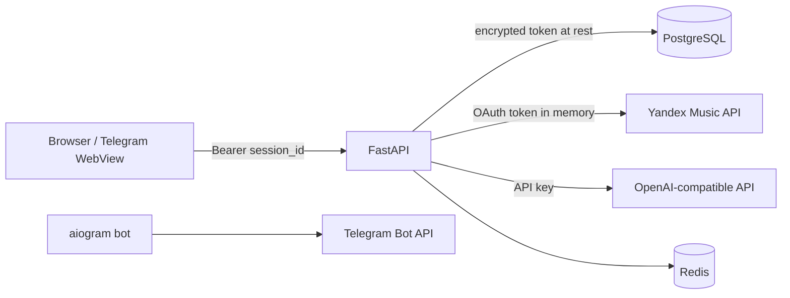

# Security-модель

Документ описывает подтверждённую реализацию, а не security certification.

## Trust boundaries

Browser не получает OAuth-токен Яндекса. После Device Flow backend шифрует его
Fernet-ключом и возвращает случайный UUID `session_id`.

## Authentication

`backend/app/api/deps.py:get_current_session`:

1. требует `Authorization: Bearer <UUID>`;
2. загружает session и user;
3. проверяет `expires_at` относительно UTC;
4. при ошибке возвращает `401`.

Пользовательские endpoints LLM, retrieval, Yandex account и playlists требуют
эту dependency. `GET /health`, Device Flow start/poll и
`POST /scoring/rank` публичны. Scoring endpoint принимает кандидатов от клиента
и может потреблять CPU без auth или rate limit.

Endpoint метрик использует отдельный shared secret
`X-Metrics-Token`; сравнение выполняется `secrets.compare_digest`. Пустой
`METRICS_TOKEN` отключает endpoint ответом `503`.

## Хранение credentials

- OAuth-токен: `sessions.encrypted_token`, Fernet encryption в
  `backend/app/core/security.py`.
- Fernet даёт confidentiality и integrity ciphertext, но доступ к БД и
  `TOKEN_ENCRYPTION_KEY` вместе позволяет расшифрование.
- API keys и bot token читаются из environment/`.env`; secret manager
  integration в репозитории отсутствует.
- `.env.example` содержит только пустые placeholders. Реальные `.env` и токены
  нельзя добавлять в Git, логи или документацию.

Rotation `TOKEN_ENCRYPTION_KEY` не реализован: простая замена ключа сделает
существующие sessions нечитаемыми. Нужна отдельная процедура re-encryption либо
принудительная повторная авторизация.

## Telegram

`backend/app/core/telegram_webapp.py` проверяет HMAC Telegram WebApp `initData`
и ограничивает возраст `auth_date` 24 часами. После проверки
`telegram_user_id` привязывается к уже аутентифицированной Prompt DJ session.
Без `TG_BOT_TOKEN` операция отклоняется.

## Browser session

Frontend хранит `session_id` в `localStorage` под ключом
`prompt_dj_session_id` и добавляет его в Authorization header. Это исключает
cookie-based CSRF, но делает token доступным любому JavaScript, исполняющемуся
в origin; XSS может привести к краже session. CSP и httpOnly cookie flow в
репозитории не реализованы.

Logout очищает только `localStorage`. Server-side revoke endpoint отсутствует,
поэтому скопированный Bearer остаётся действительным до `expires_at`.

## CORS и transport

FastAPI применяет только `CORSMiddleware`:

- origins — exact CSV из `CORS_ORIGINS`;
- `allow_credentials=False`;
- методы и заголовки разрешены все.

Trusted host, HTTPS redirect, CSRF middleware, request size limit и rate
limiting в приложении отсутствуют. TLS и reverse proxy не определены Compose;
их должен предоставлять deployment environment. Порты PostgreSQL и Redis в
текущем Compose опубликованы на host и подходят только для локальной разработки.

## Авторизация объектов

History, generation, cover, feedback и track edit запрашиваются через
`get_by_id_for_user(generation_id, user_id)`, поэтому проверяют ownership.
`source_id` также должен принадлежать текущему user в service. Роль/permission
model кроме ownership и metrics shared secret отсутствует.

## Sensitive data и логи

В БД хранятся Yandex UID/login, Telegram user ID, промпты, история треков и
зашифрованный OAuth-токен. Retention/deletion API и data classification policy
не реализованы. Pipeline logs содержат метрики и UUID generation, но код не
должен логировать OAuth/API keys.

## Подтверждённые ограничения

| Приоритет | Ограничение | Рекомендация |
|---|---|---|
| High | Нет server-side revoke/logout | Добавить revoke и очистку expired sessions |
| High | Нет rate limit, public scoring CPU surface | Ограничить endpoint auth/rate limit или не публиковать его |
| High | Нет документированной Fernet rotation | Ввести versioned keys и re-encryption runbook |
| Medium | Bearer в `localStorage`, нет CSP | Уменьшить XSS surface; оценить httpOnly session |
| Medium | Dev Compose публикует DB/Redis | Не использовать topology как production |
| Medium | Нет secret manager/deployment policy | Определить внешний secrets lifecycle |

Это риски, а не утверждение о подтверждённой эксплуатации уязвимости.
